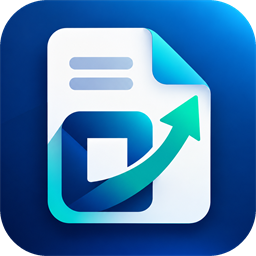

# Optim PDF



**View, edit, sign and convert PDFs on Windows. Works offline, with no account.**

Optim PDF is a desktop PDF editor for Windows 10 and 11 by Optim Square LLC, built with .NET 10 and WPF on top of the
PDFium rendering engine and the PDFsharp writer.

## Features

- **View:** tabs, continuous scrolling, zoom, thumbnails, bookmarks, search, light and dark themes, high-DPI
- **Edit:**
  - add text and images;
  - edit existing text in place;
  - select, move, resize and delete text, images and signatures;
  - Arabic, Persian and Hebrew text
- **Comment:** highlight, underline, strikethrough, notes, text boxes, drawing, stamps
- **Pages:** insert, delete, reorder, rotate, crop, extract, split, merge
- **Forms:** fill fields directly on the page (Tab between fields); create text fields, check boxes, dropdowns and signature fields; flatten
- **Sign:**
  - visual signatures (drawn, typed or image);
  - certificate-based PAdES digital signatures with optional RFC 3161 time-stamps;
  - signature validation
- **Protect:** AES-256 passwords and permissions, true redaction (content is removed, not covered), removal of hidden information
- **Convert:**
  - text recognition (OCR) with the Windows OCR engine;
  - Word, Excel and PowerPoint to PDF, and PDF to Word (uses Microsoft Office when installed);
  - images ↔ PDF;
  - compression
- **Batch:** compress, protect, OCR, convert, export, rename or merge many files at once
- **Safety:** atomic saves with backups, undo/redo, autosave and crash recovery

Known limitations are listed in [docs/03-status.md](docs/03-status.md).

## Requirements

- Windows 10 (1809) or later, x64
- To build: [.NET 10 SDK](https://dotnet.microsoft.com/download)
- Optional: Microsoft Office (Office conversion); Windows OCR languages (text recognition)

## Build and run

```powershell
dotnet build OptimPdf.slnx
dotnet test tests/OptimPdf.Core.Tests
dotnet run --project src/OptimPdf.App -- "C:\path\to\file.pdf"
```

## Installer

```powershell
.\installer\build.ps1                          # artifacts\OptimPdf-<version>-x64.msi
.\installer\build.ps1 -CertThumbprint <sha1>   # signed with a code-signing certificate
msiexec /i artifacts\OptimPdf-<version>-x64.msi /qn ALLUSERS=1   # silent per-machine install
```

The MSI is self-contained (no separate .NET install needed) and supports per-user or per-machine installation.
WiX Toolset 5 is restored automatically as a local dotnet tool.

## Project layout

| Path | Contents |
|------|----------|
| `src/OptimPdf.Core` | UI-free engine: rendering, editing, annotations, pages, forms, security, signatures, OCR, conversion, batch |
| `src/OptimPdf.App` | WPF application: ribbon, document tabs, side panels, dialogs |
| `tests/OptimPdf.Core.Tests` | xUnit tests; they generate their own PDFs and verify results by re-rendering and re-parsing |
| `installer` | WiX installer source and the third-party license texts it ships |
| `docs` | Architecture and implementation status |

## Keyboard shortcuts

Ctrl+O open · Ctrl+S save · Ctrl+P print · Ctrl+W close tab · Ctrl+Z / Ctrl+Y undo/redo · Ctrl+F search ·
F3 next match · Ctrl+plus/minus/0 zoom · Ctrl+F1 collapse ribbon · F4 side panel · Arrow keys nudge a selected item ·
Delete removes it · Esc back to the Select tool

## License

Optim PDF is released under the [MIT License](LICENSE). It includes open-source components under their own licenses
(PDFium, PDFiumCore, PDFsharp, .NET and others); see [THIRD-PARTY-NOTICES.txt](THIRD-PARTY-NOTICES.txt) and
`installer/licenses`.
